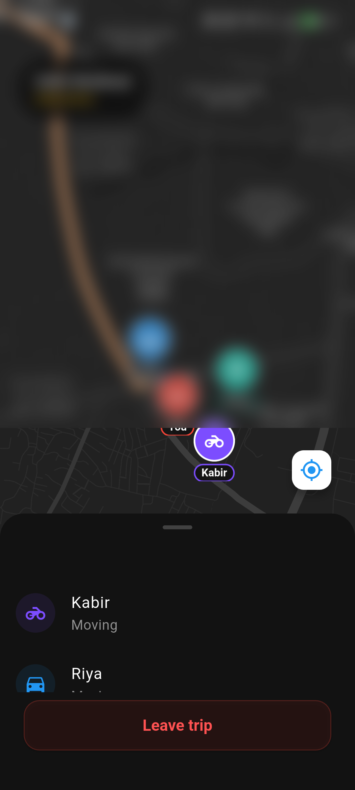
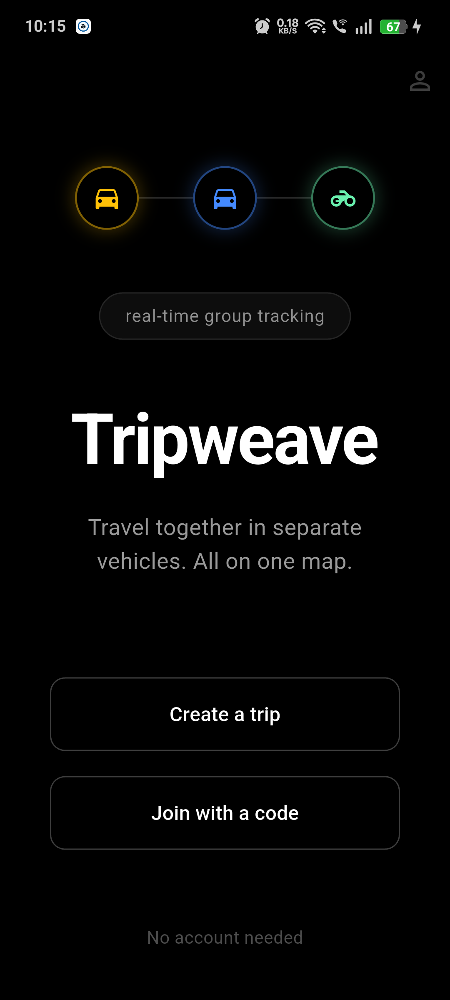
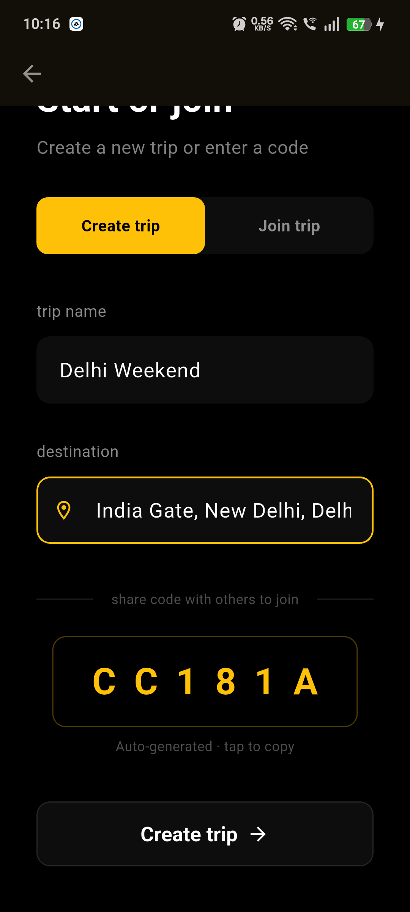
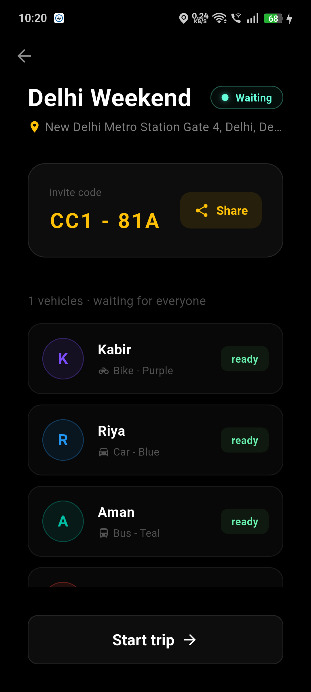
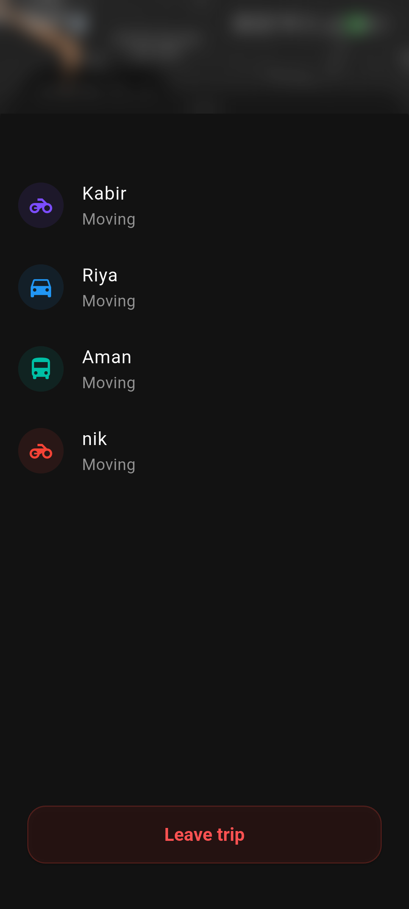
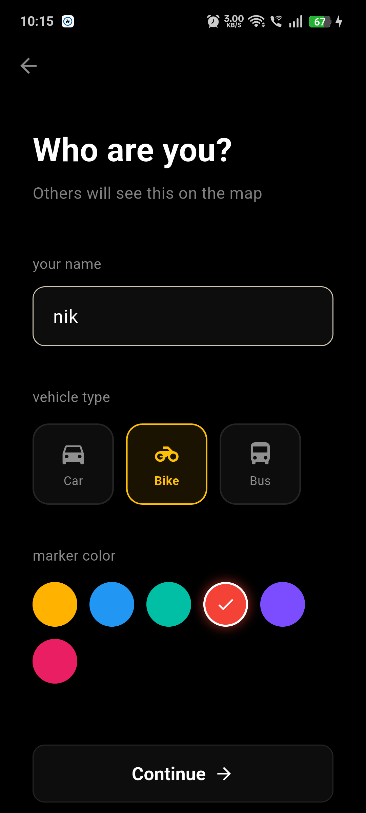
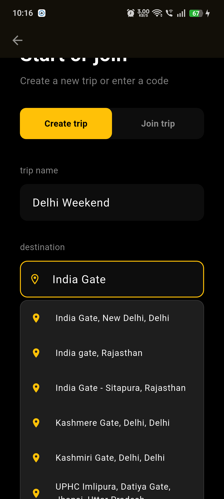
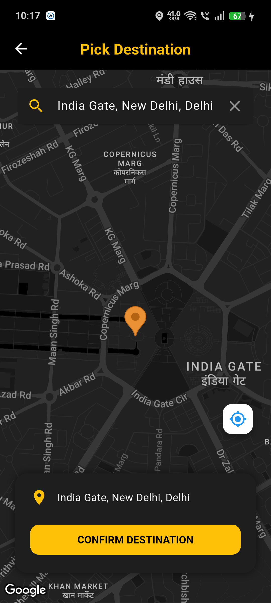
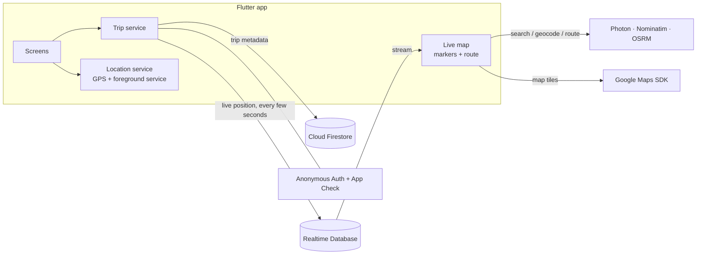
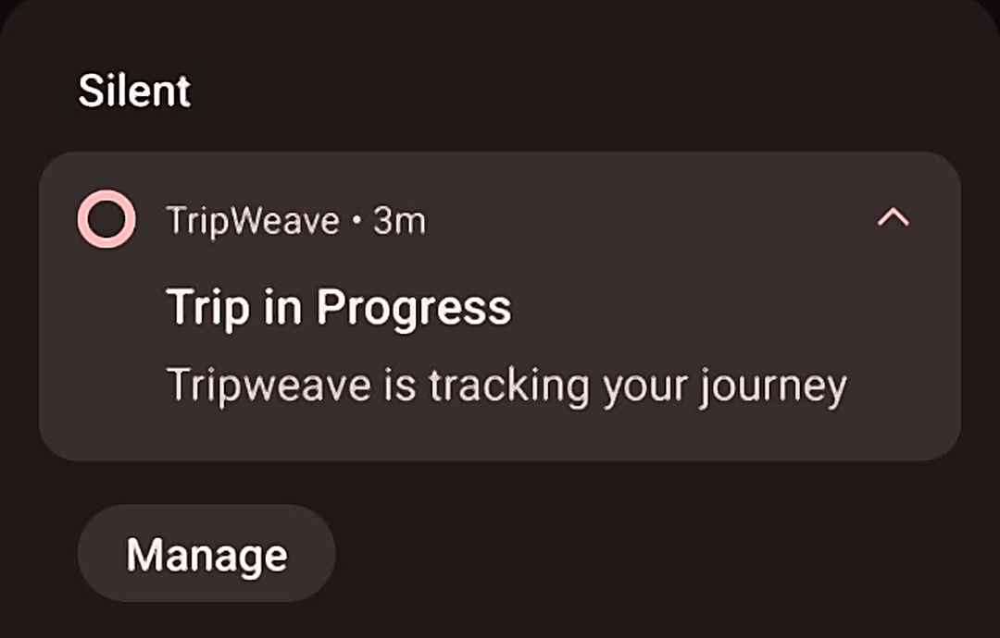

# Case study: TripWeave — real-time convoy tracking in Flutter + Firebase

**Role:** sole developer. Design, Flutter app, Firebase backend and security rules, Android native code, testing on real devices, and the Play Store release.
**Timeline:** about 3 months (Jun – Sep 2026), from an empty project to a signed release on Google Play closed testing.
**Stack:** Flutter · Dart · Firebase (Anonymous Auth, Cloud Firestore, Realtime Database, App Check, Hosting) · Google Maps SDK · Kotlin platform channel · OpenStreetMap services (Photon, Nominatim, OSRM)

> The source code is private. This page explains what I built, the hard problems I solved and the decisions behind them.

  

<a href="https://youtube.com/shorts/0cEL2-50uW8"><b>▶ Watch the 45-second demo</b></a>

---

## The problem

When friends drive to the same place in separate cars, coordination breaks down. People end up calling each other and asking "where are you now?" in a group chat while driving. Map apps share one person's location with another, but not **a whole group, on one map, for one trip**.

**Goal:** anyone can create a trip, share a short code, and everyone who joins sees each vehicle live on a single map, with the route to the shared destination. No sign-up, no account, and nothing that costs per request.

## What I built

| Home | Create trip | Lobby | Live map | Member sheet |
|:---:|:---:|:---:|:---:|:---:|
|  |  |  |  |  |

- **Join by code:** the creator gets a 6-character code; everyone else types it in. Firebase Anonymous Auth means no accounts.
- **Live shared map:** every member appears as a custom-drawn vehicle marker (car, bike or bus) in their own colour with a name tag. Positions update in real time.
- **Lobby, then trip:** members gather and mark themselves ready; only the creator can start, and everyone moves to the map together.
- **Destination search and routing with no API cost:** search as you type, pick a point on the map with reverse geocoding, and a road route drawn to the destination.
- **Background tracking:** location keeps publishing with the screen locked, through an Android foreground service.
- **Clean exits:** leaving, killing the app or losing the connection removes your marker automatically, so no ghost vehicles are left behind.

| Profile | Destination search | Pick on map |
|:---:|:---:|:---:|
|  |  |  |

## Architecture

**Key decision: two databases on purpose.** Trip metadata (name, destination, code, members, status) changes rarely and needs queries like "find the trip with this code", so it lives in **Firestore**. Live positions change every few seconds for every member, so they go to the **Realtime Database**, which is built for small, low-latency writes and is much cheaper for this pattern. Location is never written to Firestore.

**Key decision: a zero running cost.** Only the Google Maps display SDK needs a key. Places, Directions and Routes APIs are deliberately not used (search, reverse geocoding and routing come from OpenStreetMap services instead), and everything runs on Firebase's free tier.

## Hard problems I solved

These are the problems that took real debugging, most of them found only by testing on physical phones.

**1. Background GPS silently stopped after the first fix.**
The app published one position, then nothing, with no crash and no error. The cause was that enabling a wake lock on the foreground service throws a `SecurityException` unless the manifest declares `WAKE_LOCK`, and the location stream quietly never opened. I added the permission and then verified tracking on a genuinely locked phone, confirming it with `adb dumpsys` that the service was still alive rather than trusting the UI.

 The foreground-service notification while tracking with the screen locked.

**2. The release build broke features that worked in debug.**
In the release (R8-minified) build, App Check failed to load: R8 had stripped Firebase's component constructors. I diagnosed it from logcat (`ComponentDiscovery … NoSuchMethodException`) and wrote ProGuard keep rules. Since then I test every release build, not only debug.

**3. The map was blank in the Play-installed app.**
After enrolling in Play App Signing, Google re-signs the app with its own key, so the Maps and Firebase key restrictions no longer matched. I pulled the APK from a real Play install, verified which certificate was actually on the device with `apksigner`, and registered the right fingerprints.

**4. Security rules that validate every write on the server.**
A user can only write their own live node. Field names, types, ranges and lengths are enforced (for example, latitude within ±90, a name of at most 30 characters, no unknown fields). In Firestore only members can read a trip, joining can only add yourself, only the creator can start it, and code lookups are capped at one result so trips can't be enumerated. I verified the rules with 24 automated allow/deny scenarios against the live project.

**5. Trip codes were more guessable than they looked.**
In a security review of my own code I found that the code generator truncated a UUID, so it only ever used hex digits (16 symbols instead of 36), a keyspace about 130× smaller than intended. I replaced it with a CSPRNG drawing uniformly from the full alphabet and added regression tests for the format and the keyspace.

**6. Ghost markers.**
A member whose app was killed or lost signal left a frozen vehicle on everyone's map. Their node is now removed by the database itself on disconnect (`onDisconnect`), and the handler is re-armed on every reconnect.

**7. "Moving" never changed to "Stopped".**
The status was written as "moving" on every update, and because the GPS stream filters out small movements, no update ever arrives once someone stops. A fix at write time alone could never work, so status is now derived from how recently a position arrived and re-checked on a timer. I confirmed it live: it showed "Moving" after a fresh fix and flipped to "Stopped" once the phone sat still.

**8. Search silently returned nothing.**
The geocoding service rejected one query parameter (HTTP 400) and blocked Dart's default User-Agent (HTTP 403), and the errors were being swallowed. I fixed the request, sent an identifying User-Agent, and made non-200 responses visible in the logs.

**9. Concurrent marker rebuilds.**
Two streams (my own GPS and everyone else's positions) rebuilt markers at the same time and raced. I guarded the rebuild with a mutex and a "resync pending" flag, so no update is lost and none is drawn twice.

**10. "Turn on location" sent people to Settings.**
I wrote a small Kotlin platform channel that shows Google's native in-app "Turn on location" dialog, then re-centres the map automatically once a fix arrives.

## Security, privacy and release work

- Firebase **App Check** (Play Integrity) is integrated and registered, ready to enforce.
- **No secrets in the repo:** API keys live in git-ignored files, a **gitleaks** pre-commit hook blocks any commit containing a key, and I purged a previously committed key from the whole git history with `git filter-repo`.
- **Data minimisation:** no email, phone number or contacts are collected. Location is shared only inside a trip you joined, only while you're in it, and is deleted when you leave.
- **Hardened Android build:** HTTPS only, no cloud backup of app data, no background-location permission (a foreground service is used instead).
- **Dependencies** are scanned against the OSV database and watched by Dependabot.
- **Privacy policy and terms** are hosted on Firebase Hosting with security headers (CSP, HSTS, no framing) and linked from the app.
- **Play Store:** upload keystore, Play App Signing, a Data Safety form, a store listing and screenshots, and a signed release live on closed testing.
- **Trade-off, documented honestly:** a stricter server-side membership check would need Cloud Functions, which require Firebase's paid plan. For this free-tier app I chose to keep the free plan and wrote the trade-off down. I built the stricter version, a membership mirror maintained by a Cloud Function and covered by emulator tests, into a separate starter kit, [Live Convoy Kit](https://harborkits.gumroad.com/l/tjlbf).

## Results

- A working app on **Google Play closed testing**, signed through Play App Signing.
- **Two-phone field test passed:** join by code, live tracking in both directions, background tracking with the screen locked, updates skipped while stationary and resumed after about 30 m of movement, and a clean leave, with no errors in either phone's logs.
- About **3,400 lines of Dart**, with unit tests for input validation, trip-code entropy and the moving/stopped logic, and a clean `dart analyze`.
- **₹0 running cost:** Firebase free tier, OpenStreetMap services, no paid map APIs.

## What this means for your project

I can take a Flutter app from idea to Play Store, and I'm strongest at the parts that usually go wrong:

- **Real-time features:** live location, chat or presence on Firebase (Firestore / Realtime Database)
- **Background location on Android** that keeps running with the screen locked
- **Firebase security rules and App Check:** written, tested and explained
- **Release problems:** R8/ProGuard, signing, SHA keys, Play App Signing, blank maps in production
- **Play Store launch:** Data Safety form, privacy policy, testing tracks

**Hire me:** [Upwork](https://www.upwork.com/freelancers/~0198a832f4cfda1c92) · [GitHub](https://github.com/Nikhil-1501)
